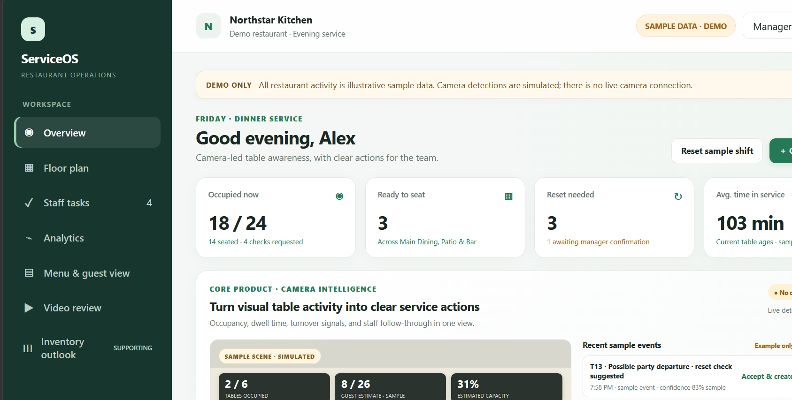
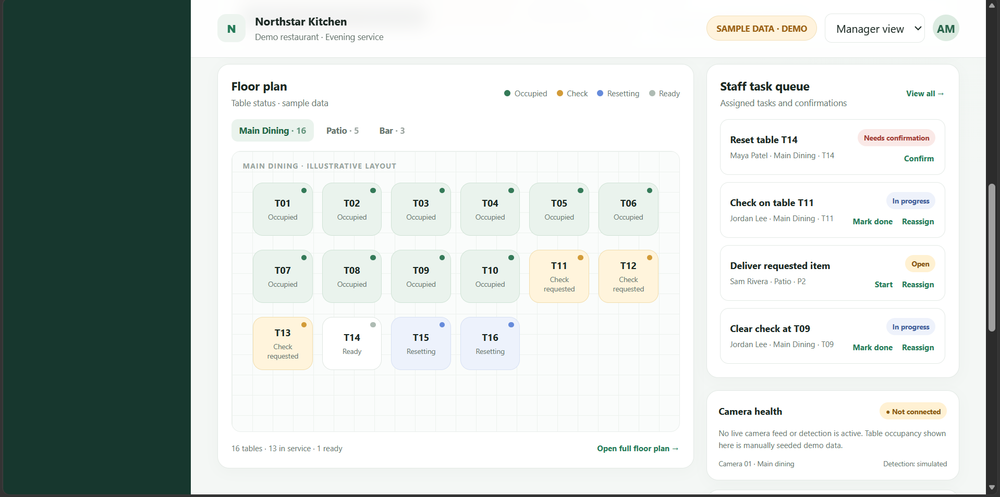
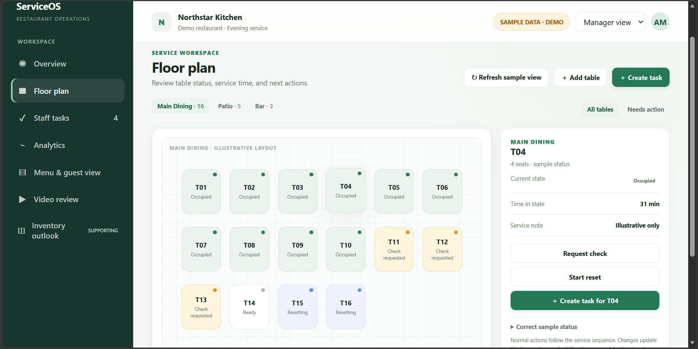
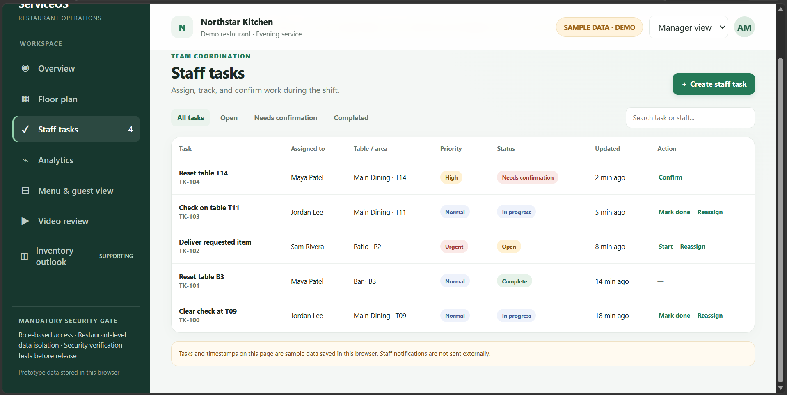
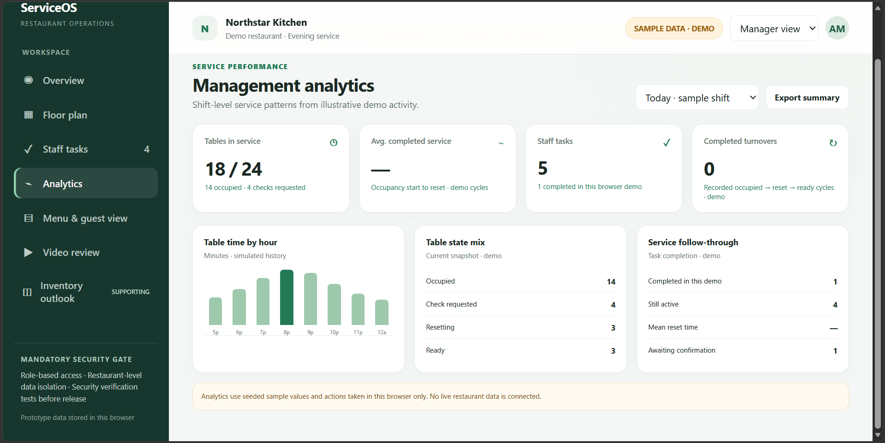
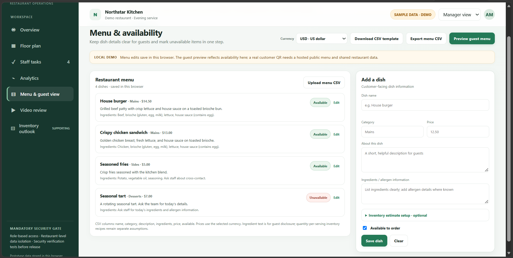
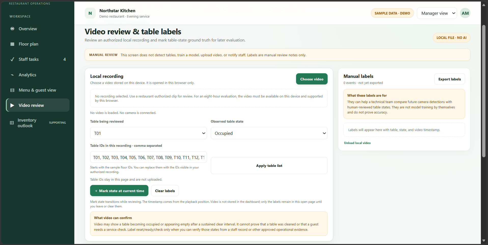
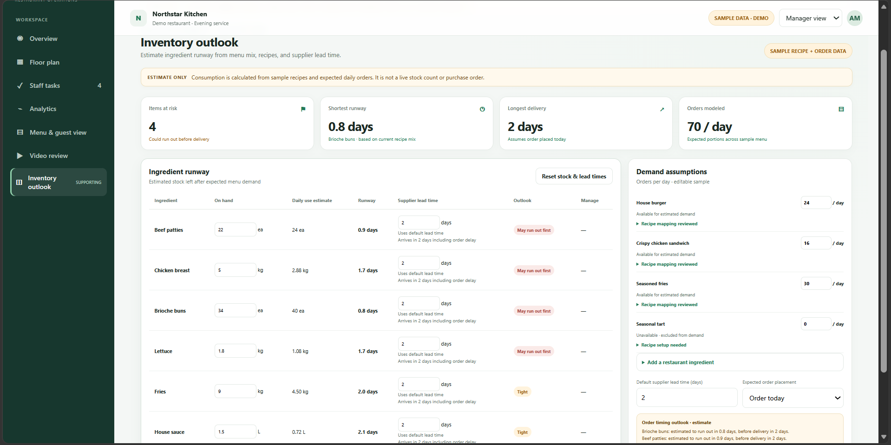

# ServiceOS | Restaurant Operations Demo

ServiceOS is a browser-based prototype for a camera-first restaurant operations workflow. It brings table status, service tasks, menu availability, and shift reporting into one workspace.

**This is a local demo, not a live service.** Table signals and restaurant activity use sample data. No camera feed, computer-vision model, staff notification, customer QR menu, or shared restaurant account is connected.

## Run the demo

Open `index.html` in a current desktop browser. The demo runs locally and does not require an account or installation. Its changes are stored in that browser.

## Explore

- **Overview:** review sample occupancy, service actions, and camera health.
- **Floor plan:** inspect table states and record manual service updates.
- **Staff tasks:** assign and complete tasks in the demo workflow.
- **Analytics:** view shift summaries based on sample activity.
- **Menu & guest view:** edit dishes, ingredients, prices, and availability; preview the guest menu on the same device.
- **Video review:** play a video selected from this device and add manual table-state labels. The page does not detect tables or train a model.
- **Inventory outlook:** estimate ingredient runway from entered recipes, demand, stock, and supplier lead times. It does not place orders.

Select **Reset sample shift** to restore the starting table and task data. Menu and inventory settings are kept in the browser.

## Screenshots

The captures below show the current sample-data interface. Camera states are simulated.

<table>
<tr>
<td align="center"> Overview</td>
<td align="center"> Floor and task panels</td>
</tr>
<tr>
<td align="center"> Floor plan</td>
<td align="center"> Staff tasks</td>
</tr>
<tr>
<td align="center"> Management analytics</td>
<td align="center"> Menu manager</td>
</tr>
<tr>
<td align="center"> Video review</td>
<td align="center"> Inventory outlook</td>
</tr>
</table>

The guest-menu preview capture has not been added yet. See [`screenshots/README.md`](screenshots/README.md) for image notes.

## Project files

- [`REAL_WORLD_BUILD_PLAN.md`](REAL_WORLD_BUILD_PLAN.md) — implementation phases and mandatory security checklist.
- [`CAMERA_INFO_GUIDE.md`](CAMERA_INFO_GUIDE.md) — how to identify an IP camera or NVR model and supported protocols.
- [`CAMERA_COMPATIBILITY_MATRIX.md`](CAMERA_COMPATIBILITY_MATRIX.md) — record device tests and compatibility evidence.
- [`API_CONTRACT.md`](API_CONTRACT.md) — proposed backend data and API design.
- [`SHOWCASE_RELEASE_GUIDE.md`](SHOWCASE_RELEASE_GUIDE.md) — presentation and release notes.
- [`menu-template.csv`](menu-template.csv) — menu import template.

## Before a pilot

The first restaurant and camera/NVR model have not been selected. A production pilot still needs a shared backend, authenticated accounts, server-enforced roles and restaurant isolation, a qualified camera integration, and security verification. The consolidated security checklist in `REAL_WORLD_BUILD_PLAN.md` is a mandatory release requirement.
